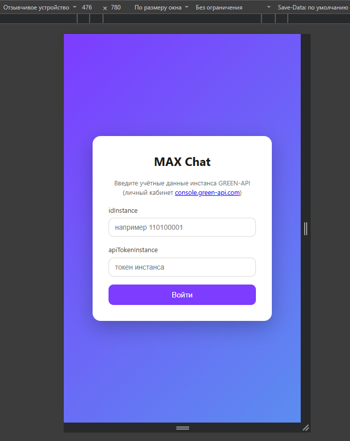
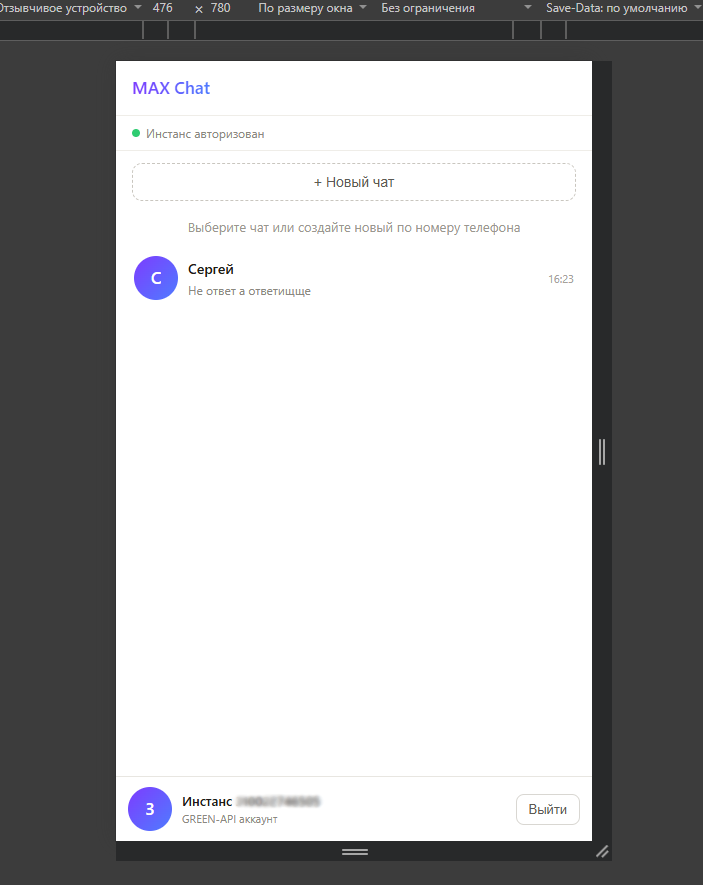
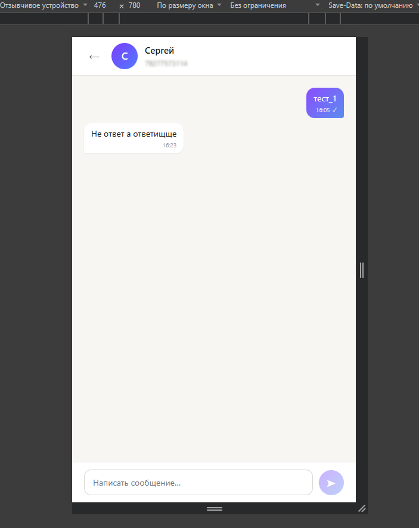

# MAX Chat

Веб-интерфейс для отправки и получения текстовых сообщений в мессенджере **MAX** через сервис [GREEN-API](https://green-api.com/max). UI выполнен по прототипу [web.max.ru](https://web.max.ru/).

## Возможности

- Вход по учётным данным инстанса GREEN-API (`idInstance`, `apiTokenInstance`) с проверкой через `getSettings`
- Создание чата по номеру телефона получателя (проверка аккаунта и получение `chatId` через `checkAccount`, имя контакта — через `getContacts`)
- Отправка текстовых сообщений методом [`SendMessage`](https://green-api.com/v3/docs/api/sending/SendMessage/)
- Получение сообщений по HTTP-технологии [`ReceiveNotification` → `DeleteNotification`](https://green-api.com/v3/docs/api/receiving/technology-http-api/) (polling каждые 5 секунд)
- Список чатов, история сообщений, статусы отправки (⏳ / ✓ / ✓✓ / ✕)
- Статусы доставки и прочтения исходящих сообщений (вебхуки `outgoingMessageStatus` / `outgoingMessageDelivered` / `outgoingMessageRead`)
- Счётчики непрочитанных сообщений в списке чатов
- Индикатор состояния инстанса в сайдбаре (`stateInstance`) с предупреждением, если инстанс не авторизован или входящие уведомления выключены
- Мобильная адаптация: на экранах до 768px список чатов и переписка переключаются (кнопка «←»)
- Сохранение чатов и истории в `localStorage` (переживают перезагрузку страницы)
- Статусы, сообщения об ошибках и пустые состояния
- Unit-тесты чистой логики (`npm test`, Vitest)

Технологии: **React 18 + TypeScript + Vite**. Без бэкенда — всё работает напрямую с GREEN-API из браузера.

## Предварительные требования

1. Аккаунт в GREEN-API и **созданный инстанс MAX** — [console.green-api.com](https://console.green-api.com/)
2. Инстанс авторизован (QR-код отсканирован в приложении MAX: _Настройки → Устройства → Подключить устройство_)
3. В карточке инстанса (**Изменить**) включена настройка **«Получать уведомления о входящих сообщениях и файлах»** (`incomingWebhook: yes`)
4. Поле **`webhookUrl` пустое** — иначе уведомления уходят вебхуком, а не в HTTP-очередь, и чат их не получит

> Настройки также можно применить методом [SetSettings](https://green-api.com/v3/docs/api/account/SetSettings/) с телом
> `{"webhookUrl": "", "incomingWebhook": "yes", "outgoingWebhook": "yes", "stateWebhook": "yes"}`

## Локальный запуск

Требуется Node.js 18+.

```bash
# 1. Установить зависимости
npm install

# 2. Запустить dev-сервер
npm run dev

# 3. (опционально) Запустить unit-тесты
npm test
```

Открыть в браузере http://localhost:5173

### Сценарий проверки

1. Ввести `idInstance` и `apiTokenInstance` из карточки инстанса в личном кабинете GREEN-API → **Войти**
2. Нажать **+ Новый чат** → ввести номер телефона получателя в международном формате (РФ: 11 цифр, начиная с `7`; РБ: 12 цифр, начиная с `375`) → **Создать чат**
3. Написать сообщение и отправить (Enter) — оно придёт получателю в MAX
4. Получатель отвечает в MAX — ответ появляется в чате в течение ~5 секунд

## Сборка и деплой

```bash
npm run build     # продакшн-сборка в папку dist/
npm run preview   # локальный предпросмотр сборки
```

### GitHub Pages

Проект настроен на автодеплой через GitHub Actions (`.github/workflows/deploy.yml`): пуш в `main` собирает приложение и публикует его на Pages.

1. Создать репозиторий на GitHub и запушить проект в ветку `main`
2. В настройках репозитория: **Settings → Pages → Source: GitHub Actions**
3. После завершения workflow приложение будет доступно по адресу `https://<username>.github.io/<repo-name>/`

> ⚠️ Параметр `base` в `vite.config.ts` должен совпадать с именем репозитория (сейчас — `/Green_Api/`). При другом имени репозитория измените `base` и пересоберите проект.

## Структура проекта

```
src/
├── api/greenApi.ts          # Клиент GREEN-API: getSettings, checkAccount,
│                            # getContacts, sendMessage, receive/deleteNotification
├── components/
│   ├── LoginScreen.tsx      # Экран входа с проверкой учётных данных
│   ├── ChatScreen.tsx       # Экран чата (список + окно сообщений)
│   ├── ChatList.tsx         # Список чатов и создание чата по номеру
│   └── ChatWindow.tsx       # Лента сообщений и поле ввода
├── hooks/
│   ├── useCredentials.ts    # Хранение кредов (localStorage)
│   └── useChatStore.ts      # Состояние чатов + polling-цикл получения сообщений
├── types.ts                 # Модели Chat / Message
└── index.css                # Стили (прототип web.max.ru)
```

## Безопасность

В рамках тестового задания (максимально простой интерфейс без бэкенда) учётные
данные инстанса (`idInstance`, `apiTokenInstance`) хранятся в `localStorage`
браузера — так же, как в официальном демо GREEN-API. Кнопка «Выйти» удаляет их.

В продакшене архитектура была бы иной: собственный бэкенд выдавал бы сессию
через `HttpOnly`-cookie, все запросы к GREEN-API шли бы с сервера, и токен
инстанса никогда не попадал бы в браузер.

## Хранение и синхронизация истории

Приложение не имеет бэкенда, поэтому история устроена так:

1. **Чаты и сообщения кешируются в `localStorage`** (ключ `green-api-chats:{idInstance}`) — при перезагрузке страницы список и переписка появляются мгновенно, из локального кеша.
2. **Новые сообщения приходят через polling** (`receiveNotification` каждые 5 секунд) и **сливаются с кешем с дедупликацией по `idMessage`** — сообщение, уже сохранённое локально, не задвоится.

Границы этого механизма (следствие HTTP-технологии GREEN-API):

- Очередь уведомлений хранится на стороне GREEN-API **24 часа**. Уведомления, не забранные за это время (или уже подтверждённые через `deleteNotification` ранее), в приложение не попадут — полной серверной истории нет.
- Механизм односторонний: изменения, сделанные в самом MAX (удаление сообщения, правки), не отражаются в веб-интерфейсе.
- Поэтому `localStorage` — кеш и «докачка» свежих сообщений, а не гарантированная копия переписки. Для полной истории понадобился бы метод `getChatHistory`, что выходит за рамки минимального набора функций из задания.

## Ограничения

- Только текстовые сообщения (по требованиям задания)
- Длина сообщения — до 4000 символов (лимит GREEN-API)
- Смотри также «Хранение и синхронизация истории» выше — ограничения очереди уведомлений (24 часа)

## Скриншоты

| Экран входа                           | Список чатов                               | Переписка                          |
| ------------------------------------- | ------------------------------------------ | ---------------------------------- |
|  |  |  |
